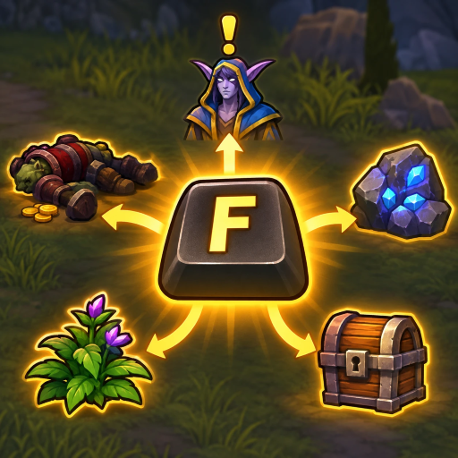

<p align="center">
  
</p>

# One Key Interact

Press one key to loot nearby corpses one after another, talk to NPCs, and gather ores and herbs in **World of Warcraft: Forever**.

The default key is <kbd>F</kbd>. You can change it in the menu, and choose which types of target the key works on.

## Features

- **One key for everything nearby:** the game highlights the closest target and the key interacts with it.
- **Chain looting:** with auto loot on, each press empties a corpse and the next press moves to the next one.
- **Target filters:** turn corpses, NPCs, ores, herbs and other objects on or off.
- **Simple menu:** click a button and press the key you want, including Shift, Ctrl or Alt combinations.
- **Easy to undo:** your normal keybind is never overwritten, and turning the addon off restores your settings.

## Installation

1. Close the game, or log out to the character select screen.
2. Copy the `QuickInteract` folder into your AddOns folder:

   ```text
   World of Warcraft\_forever_\Interface\AddOns\QuickInteract
   ```

3. Start the game and make sure **One Key Interact** is ticked in the AddOns list on the character select screen.

> [!IMPORTANT]
> The folder must be named exactly `QuickInteract`, and `QuickInteract.toc` must be directly inside it. If you unzip a download and end up with a folder inside a folder, move the inner one to `AddOns`.

## How to use it in game

1. Walk near an NPC, a corpse with loot, or a gathering node.
2. Wait for the game to highlight it.
3. Press <kbd>F</kbd>.

To loot several corpses, keep pressing <kbd>F</kbd>. The game chooses which corpse comes next, usually the closest one.

### Menu

Type `/qi` to open or close the menu. You can drag the window, and <kbd>Esc</kbd> closes it.

| Option | What it does |
| --- | --- |
| **Interact key** | Click the button, then press the new key. <kbd>Esc</kbd> cancels. The line below shows what the key normally does. |
| **Enable One Key Interact** | Turns the addon on or off and restores your settings when off. |
| **Auto loot corpses** | Takes all the loot without opening a window. Needed for chain looting. |
| **Interact with** | Chooses the target types: Corpses, NPCs, Ores, Herbs and Other objects, such as chests and quest items. |

### Commands

| Command | What it does |
| --- | --- |
| `/qi` | Opens or closes the menu (`/quickinteract` also works) |
| `/qi key G` | Sets the key. Combinations like `CTRL-F` and mouse buttons like `BUTTON4` also work. |
| `/qi autoloot` | Turns auto loot on or off |
| `/qi on` / `/qi off` | Turns the addon on or off |
| `/qi status` | Shows the current settings in chat |
| `/qi check` | Shows the name and category of the highlighted target |

## What it changes in your game

While enabled, the addon sets these game options and remembers your previous values:

| Game option | Value | Effect |
| --- | --- | --- |
| `SoftTargetInteract` | `3` | Turns on the game's Interact Key highlighting |
| `SoftTargetInteractArc` | `2` | Lets targets be highlighted anywhere around you, even behind you |
| `autoLootDefault` | `1` | Turns on auto loot (only while **Auto loot corpses** is ticked) |

> [!WARNING]
> Type `/qi off` **before** uninstalling. Deleting the addon while it's on leaves these options as they are, so you would have to change them back in the game's settings.

## Limitations

- **The game picks the target.** WoW doesn't let addons choose what to interact with, so the order of corpses can't be set.
- **Filters don't skip to the next target.** If the highlighted target is a type you turned off, move until something else is highlighted. Until then, the key does its normal action.
- **Filters pause in combat.** WoW blocks keybind changes during combat, so all target types work until combat ends.
- **Full bags can stop chain looting.** A corpse with loot left on it stays targetable, so the key may keep picking it.
- **Herb and ore filters need an English game client.** On other languages, nodes count as **Other objects**. Herbs missing from the addon's list count as **Other objects** too.

## Troubleshooting

| Problem | What to try |
| --- | --- |
| `/qi` does nothing | Check the addon is ticked in the AddOns list and the folder layout matches [Installation](#installation). |
| The key does its normal action | The highlighted target's type may be turned off in the menu. Use `/qi check` to see its category. |
| An ore or herb is in the wrong category | Stand next to it and use `/qi check`. Include that line when you report it. |
| A loot window still opens | Tick **Auto loot corpses** in the menu. Holding your auto loot toggle key, Shift by default, reverses it. |
